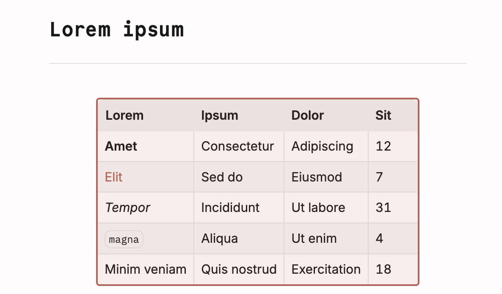

# Selectable Tables

An Obsidian plugin for Live Preview. It lets the arrow keys pass a table in one press, select a whole table as one block, the way Obsidian treats an image, and move between its cells without opening them.

Without it, every arrow press that lands in a table opens an editor for that cell. Holding ↓ through a note stalls at every table, links in the table flicker as cells switch between rendered and source text, and the table changes size as they do.



## Install

Until it's in the community plugin list, install it from a release:

1. Download `main.js`, `manifest.json` and `styles.css` from the [latest release](https://github.com/frankreporting/selectable-tables/releases/latest).
2. Put them in `<vault>/.obsidian/plugins/selectable-tables/`.
3. Reload Obsidian and enable **Selectable Tables** in **Settings → Community plugins**.

It needs Obsidian 1.14.4 or later.

## Keys

It works on every table Obsidian draws as a table in Live Preview. Source mode, Reading view, and tables inside callouts or list items (which Obsidian doesn't draw as tables in the editor) are left as they are.

**Next to a table** (the caret on the line just above or just below it):

| Key | What happens |
| -- | -- |
| ↓ from the line above, ↑ from the line below | The caret passes the table and lands on the line beyond it, at the same horizontal position. No cell opens. |
| → at the end of the line above, ← at the start of the line below | Selects the whole table, the way ← and → select an image: tinted and framed with the thick border Obsidian draws around selected cells. |
| Delete at the end of the line above | Selects the whole table, the way Backspace at the start of the line below does. |
| Any other key move that would land in the table: Option+→ or Option+← next to it, Option+↑ or Option+↓, or Cmd+↑ or Cmd+↓ when the table starts or ends the note | Selects the whole table. No cell opens. Page Up and Page Down still pass a table. |
| Shift with an arrow | The selection takes the whole table at once. |
| ↓ or ↑ with no line beyond the table (it starts or ends the note, or sits right below the properties) | Left to Obsidian, as without the plugin. Obsidian keeps a blank line around the tables it makes, so this only happens in notes written elsewhere. |

**With a table selected:**

| Key | What happens |
| -- | -- |
| ↓, →, Page Down, or Option with ↓ or → | The caret goes to the start of the line below. |
| ↑, ←, Page Up, or Option with ↑ or ← | The caret goes to the end of the line above. |
| Home, End, Cmd+←, Cmd+→, with or without Shift | Nothing happens. |
| Cmd+↑, Cmd+↓ | The note's start or end. |
| Enter | Selects the first cell, or the cell you just left with Escape. |
| Escape | The caret goes back to the side you selected the table from. |
| Backspace, Delete, Cut | Remove the table, undoable. |
| Copy | Copies the table's Markdown. |
| Typing, Tab, Shift+Enter | Nothing happens, so a stray key can't change the table. Paste replaces it, undoable. |

**With a cell selected:** it keeps showing its rendered text, with the tint and thick border Obsidian draws around selected cells. Nothing opens as you move, so the table keeps its size.

| Key | What happens |
| -- | -- |
| ↑ ↓ ← → | The selection moves one cell, and stops at the table's edge. |
| Home, End, Cmd+←, Cmd+→ | The first or last cell of the row. |
| Page Up, Page Down, Cmd+↑, Cmd+↓ | The top or bottom cell of the column. |
| Tab, Shift+Tab | The next or previous cell, wrapping between rows. It stops on the last and first cells, and adds no rows. |
| Enter | Opens the cell, with the caret at the end of its text. From there, Obsidian's table editor works as always. On a table Obsidian didn't write, such as a hand-typed one, the frame turns red and nothing opens. Click a cell to edit it: that usually tidies the table, and Enter works from then on. |
| Escape | Back to the selected table. |
| Copy | Copies the cell's Markdown, the way the cell's editor shows it. |
| Typing, Backspace, Delete, Cut, Paste, Option with an arrow, Shift with an arrow or any of the keys above | Nothing happens. Editor commands leave the table alone too. |

**In a cell**, Escape closes the cell and selects it. Page Up, Page Down, Cmd+↑ and Cmd+↓ close it and select the top or bottom cell of its column, so the note doesn't jump away from the table; press Enter to open that cell. Every other key works as Obsidian has it, and clicking a cell still edits it directly. An open cell keeps its width: only its height changes, so the columns stay put until you close it. An empty cell still grows as you type.

With Vim mode on, Vim's own keys come first: in normal mode, j, k and the arrows still step into tables.

With an input method (IME), starting to compose on a selected table or cell moves the caret beside the table, and the text lands there.

## Development

Requires Node.js 22 or later.

```bash
npm install
npm run dev         # build main.js and rebuild on every change
npm run build       # typecheck, then a production build
npm test            # unit tests (Node's built-in test runner)
npm run lint        # ESLint with Obsidian's plugin rules
```

### Test vault

`test-vault/Selectable Tables Test` is a vault of invented notes for trying the plugin by hand. Each note matches a section of the test plan.

```bash
npm run test-vault  # build, then copy the plugin into the test vault
```

Open the folder as a vault in Obsidian (**Open another vault → Open folder as vault**), turn on community plugins when asked, and enable **Selectable Tables** in **Settings → Community plugins**. Obsidian keeps its own state in the vault's `.obsidian` folder; git ignores all of it except `app.json` and `community-plugins.json`.

`scripts/make-long-note.mjs` regenerates the vault's **Long note**, which is used only for timing.

## License

[MIT](LICENSE)
