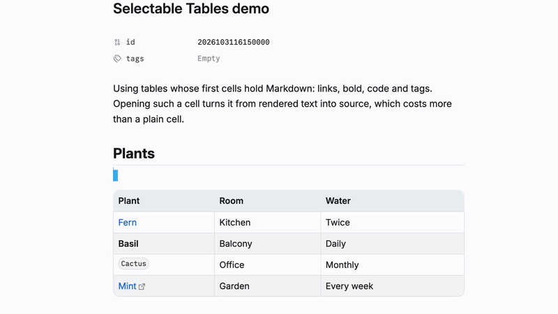

# Better Markdown Tables

*Formerly Selectable Tables.*

An Obsidian plugin that makes Markdown tables in Live Preview faster and easier to navigate. The plugin takes over rendering of each table from Obsidian, so a table of thousands of rows scrolls and takes typing much more smoothly. Select a cell and move with the arrow keys without opening anything, type to replace a cell, select a range of cells, freeze the first rows and columns, and move, add, sort and format rows, columns and cells. `Enter` drops into a cell for editing.



## Why I made this

One of the original objectives was to make scrolling notes with large tables a little more seamless, especially tables that include Markdown inside the cells, e.g. links or formatting. You can now bypass a table in one keypress rather than having to scroll through every cell, which typically results in flickering, stuttering, and a table that changes size as Obsidian tries to reveal the Markdown for every cell your caret passes.

## Install

1. In Obsidian, open **Settings → Community plugins**. If you see **Exit Restricted mode**, select it.
2. Select **Browse** and search for **Better Markdown Tables**.
3. Select **Install**, then **Enable**.

Requires Obsidian 1.15.1 or later. On an older Obsidian, the plugin stays on version 0.2.3, as Selectable Tables.

## Large tables

Only the rows near the screen are drawn, and the rest stand in at their size, so a note with a long table opens, scrolls and takes typing as fast as one without. Columns keep their widths as you scroll. On a computer, a table wider than the note scrolls sideways with a scrollbar of its own, which stays at the bottom of the pane while the table's end is out of view. A trackpad's sideways swipe over the table moves it too.

## Selecting and moving

**Next to a table** (the caret on the line just above or just below it):

| Key | What happens |
| -- | -- |
| ↓ from the line above, ↑ from the line below | Selects the whole table. The next press goes on to the line beyond, at the same place across. Hold the key down to pass tables without stopping. |
| → at the end of the line above, ← at the start of the line below | Selects the whole table, the way ← and → select an image. |
| Backspace at the start of the line below | Selects the whole table. A second Backspace removes it. |
| Any other key move that would land in the table, such as Option with an arrow | Selects the whole table. No cell opens. Page Up and Page Down pass it. |
| Shift with an arrow | The selection takes the whole table at once. |

**With the mouse:** a click on a cell selects it, and a double-click opens it, with the caret where you clicked. A click on the cell already selected opens it too. A click beside the cells selects the whole table.

**With a table selected:**

| Key | What happens |
| -- | -- |
| ↓, →, Page Down | The caret goes to the start of the line below. |
| ↑, ←, Page Up | The caret goes to the end of the line above. |
| Enter | Selects the first cell, or the cell you just left with Escape. |
| Escape | The caret goes back to the side you selected the table from. |
| Backspace, Delete, Cut | Remove the table, undoable. Paste replaces it. |
| Copy | Copies the table's Markdown. |
| Typing | Starts a new paragraph below the table, and what you type goes there. The table doesn't change, and one undo takes it all back. |

**With a cell selected:** it keeps showing its rendered text, framed as Obsidian frames selected cells. Nothing opens as you move, so the table keeps its size.

| Key | What happens |
| -- | -- |
| ↑ ↓ ← → | The selection moves one cell, and stops at the table's edge. |
| Home, End, Cmd+←, Cmd+→ | The first or last cell of the row. |
| Page Up, Page Down, Cmd+↑, Cmd+↓ | The top or bottom cell of the column. |
| Tab, Shift+Tab | The next or previous cell, wrapping between rows. It stops on the last and first cells, and adds no rows. |
| Shift with an arrow | Grows a range of cells. Shift with any of the jumps above stretches it to the table's edge. On Windows and Linux, so does Ctrl+Shift with an arrow. |
| Enter | Opens the cell, with the caret at the end of its text. |
| Typing | Replaces the cell's text, as in a spreadsheet. An accent key, such as Option+E, or an input method's first key only opens the cell, emptied: type it again there. |
| Backspace, Delete | Empty the cell, or every cell of a range. A range across whole rows or columns deletes them. |
| Cut, Copy, Paste | Copy puts a range on the clipboard as a table, as Obsidian's own table copies one. Paste writes text into the cell, or fills cells copied from a table in from the selected one, adding rows and columns to fit. |
| Bold, Italic and the other formatting commands | Format the cell's text, or every cell of a range, and take the formatting off again. |
| Option+Enter | Opens the cell's link. Cmd+Enter opens it in a new tab, Cmd+Option+Enter to the right, and Cmd+Option+Shift+Enter in a new window, or whatever keys you've set for those commands. With several links in the cell, a menu below it lists them. A picture doesn't count as a link. |
| Escape | Back to the selected table. |

**In an open cell,** the arrow keys stay in the cell's text: ← and → stop at its ends, and ↑ and ↓ go to its start or end from its first or last line. Escape closes the cell and selects it. Everything else works as in Obsidian's own cell. To stop Tab and Enter adding a row at the table's end, turn off **Tab and Enter add a row** in the plugin's settings.

With Vim mode on, Vim's own keys come first in normal mode.

## Rows, columns and cells

Obsidian's own table controls work as before: the right-click menus for a cell and a range of cells, the drag handles, the **+** buttons and the table commands.

## Freeze rows and columns

A long or wide table can keep its first rows and columns in view as you scroll, as in a spreadsheet. Any number of tables in a note can freeze. While cells pass under them, a soft shadow shows where the frozen rows and columns end. **On phones and tablets, a frozen table scrolls as usual for now: its rows and columns don't pin there.**

To freeze, right-click a cell and choose one of these, or select or open a cell and run one from the command palette (Cmd+P):

- **Freeze rows up to here:** the cell's row and every row above it.
- **Freeze columns up to here:** the cell's column and every column to its left.
- **Freeze rows and columns up to here:** both at once. On a table's first cell, that freezes the header row and the first column.
- **Unfreeze table.**

Afterwards that cell stays selected and in view.

A freeze is saved as a comment in the table's header row, such as `%%freeze 2 1%%` for 2 rows and 1 column. The commands put it in the first cell, unless the row already has one:

```markdown
| %%freeze 2 1%% Name | Bed | Sown |
| ------------------- | --- | ---- |
```

The comment doesn't show, and it stays with the table's text, so it copies, syncs and moves with the table. Copying the cell that holds it leaves it out. You can also type it yourself, in any cell of the header row.

- `%%freeze 0 0%%`, or no comment, freezes nothing. Deleting the column that holds the comment ends the freeze.
- **To freeze every table,** turn on **Freeze tables** in the plugin's settings, and choose how many rows and columns, 1 and 1 to start. It applies to every table without a comment of its own, and writes nothing into your notes. A table's own comment always wins, so `%%freeze 0 0%%` keeps a table unfrozen. On a table the setting freezes, **Unfreeze table** writes `%%freeze 0 0%%`, and the freeze commands write a comment of the table's own.
- A table can freeze up to 9 columns.
- Rows taller than half the pane, or columns as wide as the table, stop pinning until there's room, so there's always somewhere to scroll.
- Frozen rows pin a little below the top of the pane, so the header's drag handles stay in reach.
- A cell you select, open or type in comes back into view if a frozen row or column covers it.

## Themes

The plugin's table carries Obsidian's own classes for a table, so a theme's look lands on it as on Obsidian's. It's checked against the 20 most downloaded themes and Baseline. A theme's own table settings, such as row numbers, aren't followed yet.

A theme that centers tables, such as Baseline with **Table width** on **Auto (Center)**, still centers a table that fits. A wider one starts at the left edge, so you can scroll to every column.

## How the plugin changes Obsidian

Obsidian gives plugins no way to draw tables in its place, so the plugin changes a few things inside Obsidian that plugins usually leave alone. Each is checked before it's used, so an Obsidian update that changes one has the plugin step aside, as below, rather than fail.

- **It hides tables from Obsidian's own table drawing.** Each note's editor gets a copy of Obsidian's Markdown language that marks table rows with a class of the plugin's own, so Obsidian builds no table there and the plugin draws its own. *If the copy can't be made,* every table is Obsidian's own again, without the plugin's keys or freezing, and a notice says so once.
- **It borrows Obsidian's own Markdown editor for a cell,** the one Obsidian's table cells use, with the same Markdown language Obsidian gives them. While a cell is open, the note answers Obsidian's questions about which editor is active and whether the caret is in a table cell for that cell, so Obsidian's commands reach it. It also asks whether suggestions are showing, so they take the arrow keys first. *If any piece is missing,* cells open in a plain editor until Obsidian restarts, where Markdown shows as text until you leave the cell, and a notice says so.
- **It finds the link at an open cell's caret** for Option+Enter and the other link commands, with the editor Obsidian made for the cell, and opens it as Obsidian opens one in its own cell. *Without those,* the link keys do nothing in an open cell. On a selected cell, the plugin answers what Obsidian sends when it finds no link at the caret, as Obsidian's Bases table does.
- **It hands Obsidian's formatting commands to selected cells.** While the plugin draws a note's tables, Bold, Italic, Highlight, Comment, Clear formatting and the rest pass a selected cell or range to Obsidian's own formatting, run on the cells' text. *If that can't run,* nothing changes, and a notice says so once.
- **A range's right-click menu** cuts, copies and pastes through the app's window, as Obsidian's own menu does, and reads Obsidian's syntax tree to tick the formatting a range already has. *Without them,* Cut, Copy and Paste are left out of the menu, and nothing is ticked.
- **A paste into a cell reads Settings › Editor › Auto convert HTML.** *Without it,* pasted HTML is converted.
- **The right-click menu's Row, Column and Sort items are submenus,** as in Obsidian's own menu. *Without submenus,* their items follow a heading in the menu itself.

## Known issues

- The plugin draws tables only in a note's Live Preview. Everywhere else, Obsidian draws its own, without the plugin's keys or freezing: Source mode, Reading view, canvas cards, hover previews, and other editors outside a note's tab.
- Tables inside callouts or list items aren't drawn as tables in the editor, as without the plugin.
- Other plugins that work with the tables Obsidian draws in Live Preview won't find them in a note, since the plugin draws its own there.
- On phones and tablets, frozen rows and columns don't pin yet.
- A very fast flick through a long table can show blank strips for a moment, before its rows are drawn.
- Typing an accent or an input method's first key on a selected cell only opens it.

## Roadmap

What's planned, broadly. The order and the details may change.

- **Frozen rows and columns on phones and tablets,** moved sideways by a finger.
- **The plugin's table in canvas cards and hover previews.**
- **Frozen rows and columns in Reading view.**
- **Resize columns and rows** by dragging their edges.
- **Select every cell with Cmd+A,** and a range of cells with a finger.
- **Type accents and input methods** straight into a selected cell.
- **Follow a theme's own table settings,** such as row numbers.

## Feedback and bugs

Found a bug, or have an idea? [Open an issue](https://github.com/frankreporting/selectable-tables/issues/new/choose) on GitHub. The bug form asks for what helps track it down: your Obsidian and plugin versions, your device, your theme, and the keys you pressed. Issues are public, so if a table shows the problem, make up a small one rather than pasting one from your notes.

## Development

Requires Node.js 22 or later.

```bash
npm install
npm run dev         # build main.js and rebuild on every change
npm run build       # typecheck, then a production build
npm test            # unit tests (Node's built-in test runner)
npm run lint        # ESLint with Obsidian's plugin rules
```

### Test vault

`test-vault/Selectable Tables Test` is a vault of invented notes for trying the plugin by hand. Each note matches a section of the test plan.

```bash
npm run test-vault  # build, then copy the plugin into the test vault
```

Open the folder as a vault in Obsidian (**Open another vault → Open folder as vault**), turn on community plugins when asked, and enable **Better Markdown Tables** in **Settings → Community plugins**. Obsidian keeps its own state in the vault's `.obsidian` folder; git ignores all of it except `app.json` and `community-plugins.json`.

`scripts/make-long-note.mjs` regenerates the vault's **Long note**, which is used only for timing.

`scripts/make-frozen-note.mjs` regenerates **Frozen tables**, for frozen rows and columns.

## License

[MIT](LICENSE)

## Credits

Built with Claude Code.
