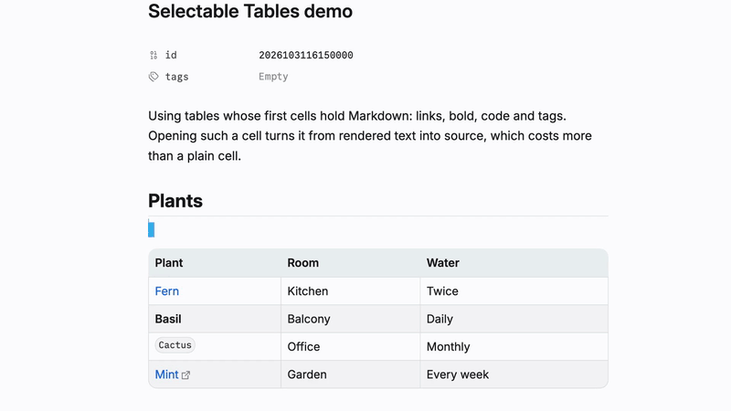

# Selectable Tables

An Obsidian plugin that enhances how you interact with Markdown tables. Treats tables as selectable blocks, the same way Obsidian treats an image. Now you can use arrow keys to select and navigate tables and cells without touching or viewing the raw Markdown, which gives you smoother note and table nav. You hit `Enter` to drop into a cell for editing. The plugin also adds the ability to freeze rows and columns. For now, all of this works only in Live Preview.



## Why I made this

One of the original objectives was to make scrolling notes with large tables a little more seamless, especially tables that include Markdown inside the cells, e.g. links or formatting. You can now bypass a table in one keypress rather than having to scroll through every cell, which typically results in flickering, stuttering, and a table that changes size as Obsidian tries to reveal the Markdown for every cell your caret passes.

## Install

1. In Obsidian, open **Settings → Community plugins**. If you see **Exit Restricted mode**, select it.
2. Select **Browse** and search for **Selectable Tables**.
3. Select **Install**, then **Enable**.

Requires Obsidian 1.14.4 or later.

## Keys

It works on every table Obsidian draws as a table in Live Preview. Source mode, Reading view, and tables inside callouts or list items (which Obsidian doesn't draw as tables in the editor) are left as they are.

**Next to a table** (the caret on the line just above or just below it):

| Key | What happens |
| -- | -- |
| ↓ from the line above, ↑ from the line below | The caret passes the table and lands on the line beyond it, at the same horizontal position. No cell opens. |
| → at the end of the line above, ← at the start of the line below | Selects the whole table, the way ← and → select an image: tinted and framed with the thick border Obsidian draws around selected cells. |
| Delete at the end of the line above | Selects the whole table, the way Backspace at the start of the line below does. |
| Any other key move that would land in the table: Option+→ or Option+← next to it, Option+↑ or Option+↓, or Cmd+↑ or Cmd+↓ when the table starts or ends the note | Selects the whole table. No cell opens. Page Up and Page Down still pass a table. |
| Shift with an arrow | The selection takes the whole table at once. |
| ↓ or ↑ with no line beyond the table (it starts or ends the note, or sits right below the properties) | Left to Obsidian, as without the plugin. Obsidian keeps a blank line around the tables it makes, so this only happens in notes written elsewhere. |

**With a table selected:**

| Key | What happens |
| -- | -- |
| ↓, →, Page Down, or Option with ↓ or → | The caret goes to the start of the line below. |
| ↑, ←, Page Up, or Option with ↑ or ← | The caret goes to the end of the line above. |
| Home, End, Cmd+←, Cmd+→, with or without Shift | Nothing happens. |
| Cmd+↑, Cmd+↓ | The note's start or end. |
| Enter | Selects the first cell, or the cell you just left with Escape. |
| Escape | The caret goes back to the side you selected the table from. |
| Backspace, Delete, Cut | Remove the table, undoable. |
| Copy | Copies the table's Markdown. |
| Typing | Starts a new paragraph below the table, with a blank line on each side, and what you type goes there. The table doesn't change, and one undo takes it all back. |
| Tab, Shift+Enter | Nothing happens, so a stray key can't change the table. Paste replaces it, undoable. |

**With a cell selected:** it keeps showing its rendered text, with the tint and thick border Obsidian draws around selected cells. Nothing opens as you move, so the table keeps its size.

| Key | What happens |
| -- | -- |
| ↑ ↓ ← → | The selection moves one cell, and stops at the table's edge. |
| Home, End, Cmd+←, Cmd+→ | The first or last cell of the row. |
| Page Up, Page Down, Cmd+↑, Cmd+↓ | The top or bottom cell of the column. |
| Tab, Shift+Tab | The next or previous cell, wrapping between rows. It stops on the last and first cells, and adds no rows. |
| Enter | Opens the cell, with the caret at the end of its text. From there, Obsidian's table editor works as always. On a table Obsidian didn't write, such as a hand-typed one, the frame turns red and nothing opens. Click a cell to edit it: that usually tidies the table, and Enter works from then on. |
| Escape | Back to the selected table. |
| Copy | Copies the cell's Markdown, the way the cell's editor shows it, without a freeze comment. |
| Typing | Starts a new paragraph below the table, as on a selected table. |
| Backspace, Delete, Cut, Paste, Option with an arrow, Shift with an arrow or any of the keys above | Nothing happens. Editor commands leave the table alone too. |

**In a cell**, Escape closes the cell and selects it. Page Up, Page Down, Cmd+↑ and Cmd+↓ close it and select the top or bottom cell of its column, so the note doesn't jump away from the table; press Enter to open that cell. Every other key works as Obsidian has it, and clicking a cell still edits it directly. An open cell keeps its width: only its height changes, so the columns stay put until you close it. An empty cell still grows as you type.

With Vim mode on, Vim's own keys come first: in normal mode, j, k and the arrows still step into tables.

Typing with an input method (IME), or an accent such as Option+E, works the same way: the text lands in the new paragraph below the table.

## Freeze rows and columns

A long or wide table can keep the initial rows and columns in view as you scroll, just like in a spreadsheet. Any number of tables in a note can freeze. This works in Live Preview, on the desktop, on phones and on tablets. **Note:** A device too old to pin rows, such as an iPhone or iPad before iOS 26, leaves the table to scroll as usual.

To freeze, right-click a cell and choose one of these, or select or open a cell and run one from the command palette (Cmd+P):

- **Freeze rows up to here:** the cell's row and every row above it.
- **Freeze columns up to here:** the cell's column and every column to its left.
- **Freeze rows and columns up to here:** both at once. On a table's first cell, that freezes the header row and the first column.
- **Unfreeze table.**

Afterwards that cell is selected and in view, and Undo takes the change back. To give a command its own keys, look it up in **Settings → Hotkeys**.

A freeze is saved as a comment in the table's header row, such as `%%freeze 2 1%%` for 2 rows and 1 column. The commands put it in the first cell, unless the row already has one:

```markdown
| %%freeze 2 1%% Name | Bed | Sown |
| ------------------- | --- | ---- |
```

The comment doesn't show, and it stays with the table's text, so it copies, syncs and moves with the table. Copying the cell that holds it leaves it out. You can also type it yourself, in any cell of the header row.

- `%%freeze 0 0%%`, or no comment, freezes nothing. Deleting the column that holds the comment ends the freeze.
- A table can freeze up to 9 columns.
- Rows taller than half the pane, or columns as wide as the table, stop pinning until there's room, so there's always somewhere to scroll.
- A cell you select, open or type in snaps back into view if it was partially hidden by a frozen cell.
- Tested in both light and dark mode on Obsidian's default theme, Baseline, Minimal, Things, Catppuccin, Prism and Blue Topaz.

### Known issues:

- On iPhone, as the keyboard opens or closes with the caret in a frozen table, its frozen rows can flicker for a moment, and the caret can drift inside its cell until you type.
- Dragging to select cells doesn't work yet with a frozen table and can result in the wrong cells selected.

## Roadmap

What's planned, broadly. The order and the details may change.

**Next:**

- **Finish freezing rows and columns:** make drags work, and freeze in Reading view too. Make it possible to keep a wide table's sideways scrollbar in view even if the bottom of the table is below the viewport.

**After that:**

- **Edit from a selected cell:** Backspace, Delete, Cut and Paste act on the cell, with nothing to open first.
- **Move rows and columns** from a selected cell, without opening the cells for edit.
- **Select a range of cells** with Shift and the arrows.

**Still being worked out:**

- The arrow keys stay in the table while a cell is open, until Escape. Currently you can move through cells freely once you're in "edit mode," and there's nothing stopping you from arrowing out of the table and then having to re-select the table and hit `Enter` again to get back in. 
- Bold, italic and other formatting act on a selected cell.
- Vim's j and k pass a table in one press, like the arrows.
- A search result in a table selects its cell instead of opening it.
- ← and → swap around a table in right-to-left text.

## Feedback and bugs

Found a bug, or have an idea? [Open an issue](https://github.com/frankreporting/selectable-tables/issues/new/choose) on GitHub. The bug form asks for what helps track it down: your Obsidian and plugin versions, your device, your theme, and the keys you pressed. Issues are public, so if a table shows the problem, make up a small one rather than pasting one from your notes.

## Development

Requires Node.js 22 or later.

```bash
npm install
npm run dev         # build main.js and rebuild on every change
npm run build       # typecheck, then a production build
npm test            # unit tests (Node's built-in test runner)
npm run lint        # ESLint with Obsidian's plugin rules
```

### Test vault

`test-vault/Selectable Tables Test` is a vault of invented notes for trying the plugin by hand. Each note matches a section of the test plan.

```bash
npm run test-vault  # build, then copy the plugin into the test vault
```

Open the folder as a vault in Obsidian (**Open another vault → Open folder as vault**), turn on community plugins when asked, and enable **Selectable Tables** in **Settings → Community plugins**. Obsidian keeps its own state in the vault's `.obsidian` folder; git ignores all of it except `app.json` and `community-plugins.json`.

`scripts/make-long-note.mjs` regenerates the vault's **Long note**, which is used only for timing.

`scripts/make-frozen-note.mjs` regenerates **Frozen tables**, for frozen rows and columns.

## License

[MIT](LICENSE)
